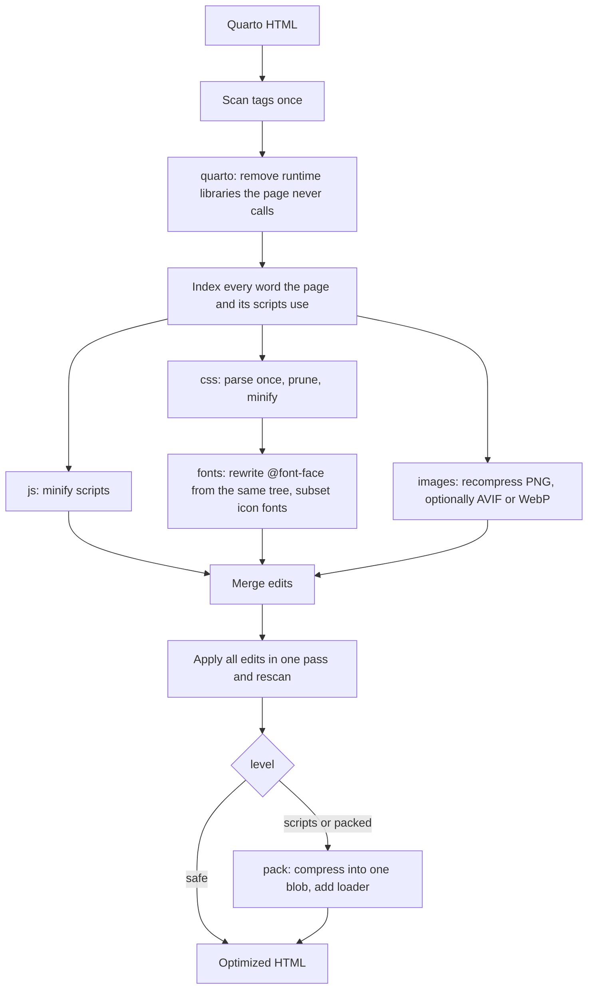

# Octavo

Octavo makes Quarto HTML files smaller. Give it a document rendered with `embed-resources: true` and it writes a single, self-contained file that opens offline and looks the same. Articles with little else in them shrink ten to twenty-five times. Slide decks full of images shrink to roughly half, because the images are most of the file.

```sh
octavo report.html                          # writes report.min.html
octavo deck.html small.html --lossy-images  # AVIF, much smaller, not pixel-exact
octavo report.html --maximum                # slowest, smallest output
octavo --audit report.html                  # what each step would save
```

Octavo does not implement a CSS minifier, a JavaScript compressor or an image codec. It knows where Quarto's weight comes from and when removing it is safe, and it hands each job to a library built for it. The libraries are listed [below](#the-libraries-doing-the-work).

## Where the bytes go

A near-empty Quarto article is about 1.2 MB, and almost none of it is your content. `embed-resources` inlines a full copy of Bootstrap's CSS (around 950 KB), an icon font, Bootstrap's JavaScript, Popper, Tippy, Clipboard.js and Anchor.js, plus the theme and highlighting styles. A page with no code block and no footnote uses almost none of that.

Octavo reads the document, works out what the page can actually reach, and removes the rest. What remains is minified, recompressed, and optionally packed into one compressed blob that a 2 KB loader unpacks while the page loads.

| Document | Before | After |
|---|---|---|
| Plain article | 1.2 MB | 46 KB |
| Article with figures | 1.3 MB | 137 KB |
| `gt` table | 1.8 MB | 310 KB |
| Plotly report | 5.7 MB | 1.6 MB |

Widget libraries such as Plotly and reveal.js ship their own minified JavaScript. That code is the floor for those pages.

## How it works

Octavo scans the document once and builds a word index of everything the page can reach. A short serial prefix removes unused Quarto libraries, because later stages depend on which scripts survive. After that the independent stages run in parallel on a rayon work queue. Each stage reads the shared scan and returns edits to byte ranges. The edits are merged and applied to the original text in one pass, so anything Octavo does not understand stays exactly as it was.

The stylesheet stage parses each stylesheet into a syntax tree once. Pruning, minification and the font facts all come from that one tree, and the font stage rewrites its `@font-face` rules in place instead of parsing the CSS again.



| Stage | What it does | What stops it |
|---|---|---|
| `quarto` | Removes Bootstrap JavaScript, Popper, Tippy, Clipboard.js and Anchor.js when the markup never uses them, and stubs the globals Quarto's own runtime calls regardless | The markup uses the library, or another script mentions it |
| `js` | Minifies scripts, and turns data-URI module scripts into inline modules | The script does not parse, or is already minified |
| `css` | Deletes rules that need a class, id or tag found nowhere in the markup or any script, then minifies. Custom property values are kept verbatim | A rule the parser rejects, and rules whose `calc()` arithmetic would lose precision, are kept exactly as written and the rest of the sheet is still optimized |
| `fonts` | Keeps the one source browsers use (the last `src`, preferring WOFF2, then WOFF, then TrueType and OpenType, and dropping legacy EOT and SVG copies), converts it to WOFF2, subsets icon fonts to the glyphs the CSS can reach, and drops fonts nothing mentions. With `--subset-text-fonts`, text fonts are also subsetted to the characters the document uses (see below) | The family name is written with escapes |
| `images` | Recompresses embedded PNGs losslessly. With `--lossy-images`, re-encodes PNG and JPEG as AVIF (or WebP), shrinking anything wider than 3840 px | Lossless skips images over 40 megapixels |
| `pack` | Gathers scripts, styles, stylesheet links, inline SVG, images and data blocks into one compressed blob, restored in place by a synchronous loader | A Content-Security-Policy meta tag; modules and import maps are never packed |

### What Octavo knows about Quarto

All Quarto-specific knowledge is in one small table in `quarto.rs`:

- Which bundled library each Quarto feature needs. Tippy and Popper power footnote, citation and cross-reference popups and code annotations. Bootstrap's JavaScript is needed for `data-bs-*` components. Clipboard.js is needed for `code-copy-button`. Anchor.js is needed for `anchored` headings.
- That Quarto's own scripts (ids starting `quarto-html-`) call those globals unconditionally. When a library is removed, Octavo leaves a null object in its place so those calls do nothing instead of throwing.
- How to recognise each library from its banner comment, so a script that only mentions `bootstrap` is not mistaken for it.

Everything else in the code only knows about HTML, CSS, JavaScript, fonts and images.

### Levels

| Level | Behaviour |
|---|---|
| `safe` | Minify and prune. Stylesheets and scripts stay real elements, so the page works with JavaScript off. |
| `scripts` | Also packs scripts and data blocks. Stylesheets and SVG stay real. |
| `packed` | Packs everything. **The page needs JavaScript to be styled.** Use it for documents that already need JavaScript. |

Output size shrinks in the order `safe`, `scripts`, `packed`: `safe` is the largest and `packed` the smallest.

### Compression effort

The level decides what the output depends on. The effort decides how hard the compressors work, and it applies at every level. The default is a balance: output a few percent above the smallest possible, in a fraction of the time. `--maximum` uses the slowest settings everywhere. Three flags set the values yourself, and none can be combined with `--maximum`:

| Flag | Range | Balanced | Maximum |
|---|---|---|---|
| `--woff2-quality` | 0 to 11 | 9 | 11 |
| `--png-preset` (oxipng) | 0 to 6 | by image size | 6 |
| `--brotli-quality` (packed blob) | 0 to 11 | 9, only for blobs big enough to beat Brotli's own decoder | 11, always |

On a 288 KB font, WOFF2 quality 9 takes 26 ms and quality 11 takes 293 ms for 9 percent more bytes, which is a small share of a whole document. That is why the default is 9.

Fonts converted whole are remembered in your user cache directory (`~/.cache/octavo` on Linux, `~/Library/Caches/octavo` on macOS, `%LOCALAPPDATA%octavo` on Windows), in a `fonts` subfolder with one file per distinct font, named by a hash of its bytes and quality. Anything else Octavo remembers later gets its own subfolder beside it. Documents from the same theme embed the same fonts, so later runs skip the slowest step. Subsetted fonts are never stored. `--cache-dir <directory>` chooses another place and `--no-cache` turns the cache off.

### What Octavo refuses

Octavo stops with a clear error instead of guessing when the input is not what it expects:

- A file with no `<html>` element is not an HTML document.
- A document that links to local files (`site_libs/bootstrap.min.css`, `figure.png`) was not rendered with `embed-resources: true`. The error lists the files.

Resources loaded from the network (a CDN script, a web font) do not stop the run. They are reported as warnings, because the page cannot work offline.

### Subsetting text fonts

`--subset-text-fonts` cuts themed documents by 30 to 56 percent, because Quarto themes embed whole fonts such as Source Sans. It is off by default because it is not exact. Some pairs ("To", "Ta" and "AV") come out about a pixel wider, so text can shift slightly and the exact checker flags it. The cause is not yet known ([issue 8](https://github.com/VisruthSK/octavo/issues/8)). Text that JavaScript adds later in a script the document does not use also falls back to a system font. Icon fonts are always subsetted, and that is exact.

### Licenses

Bundled libraries carry license banners, and MIT, BSD and Apache require them to travel with copies. Octavo keeps them by default (about 400 bytes to 2 KB per document, a few hundred after compression). Subsetting a font discards the copyright and license fields in its name table, so Octavo copies those fields (copyright line, license description, license URL) into a comment beside the font's `@font-face`. The SIL Open Font License allows a human-readable header for this. `--strip-licenses` removes all of these notices for people who ship them another way.

## The libraries doing the work

| Job | Library |
|---|---|
| Parse, prune and minify CSS | [`lightningcss`](https://crates.io/crates/lightningcss) |
| Parse, mangle and minify JavaScript | [`oxc`](https://crates.io/crates/oxc) |
| Subset fonts | [`fontcull`](https://crates.io/crates/fontcull) |
| Write WOFF2 | [`woofwoof`](https://crates.io/crates/woofwoof), which wraps Google's WOFF2 encoder |
| Decode WOFF and WOFF2 input | [`wuff`](https://crates.io/crates/wuff) |
| Recompress PNG losslessly | [`oxipng`](https://crates.io/crates/oxipng) |
| Decode PNG and JPEG | [`image`](https://crates.io/crates/image) |
| Encode lossy AVIF | [`ravif`](https://crates.io/crates/ravif), built on rav1e |
| Encode lossy WebP | [`gamut-webp`](https://crates.io/crates/gamut-webp) |
| Resize images | [`fast_image_resize`](https://crates.io/crates/fast_image_resize) |
| Deflate the packed blob | [`libdeflater`](https://crates.io/crates/libdeflater), level 12 |
| Brotli for large packed blobs | [`brotli`](https://crates.io/crates/brotli) |
| Text-safe encoding of the blob | [`base91`](https://crates.io/crates/base91) |
| Name cached fonts | [`blake3`](https://crates.io/crates/blake3) |

Apart from a small tag scanner that records byte ranges and two tiny CSS helpers (one splits a stylesheet into top-level rules, one masks license comments), Octavo parses and encodes no format by hand. The only non-Rust code in the build is the WOFF2 encoder behind `woofwoof` and libdeflate behind `oxipng` and `libdeflater`. Everything else is pure Rust.

## As a library

The `octavo` crate is the whole optimizer, and the command line is a thin wrapper around it. `Mode` is `Safe`, `Scripts` or `Packed`, matching the three command-line levels.

```rust
use octavo::{optimize, Mode};

let out = optimize(&html, Mode::Packed)?;
println!("{} -> {} bytes", html.len(), out.html.len());
for step in &out.applied {
    println!("{} {}: {} -> {}", step.transform, step.target, step.before, step.after);
}
for warning in &out.warnings {
    eprintln!("warning: {warning}");
}
```

`simplify` runs the stages that do not depend on a mode, and `Simplified::pack` finishes the result for each mode. `Simplified::pack_checked` tries a mode, hands the result to a check you supply, and steps down to the next safer mode when the check says no, so a browser comparison or any other test can sit between Octavo and the file it writes.

`Options` carries the choices that change the result, and `Compression` sets the effort:

```rust
use octavo::{simplify, Compression, Mode, Options, Tuning};

let options = Options {
    compression: Compression::Custom(Tuning { woff2_quality: 10, ..Tuning::BALANCED }),
    cache_directory: Some("fonts-cache".into()),
    ..Options::default()
};
let out = simplify(&html, options)?.pack(Mode::Packed);
```

`Compression::Balanced` is the default, `Compression::Maximum` uses the slowest settings, and `Compression::Custom` takes a `Tuning` with the three values from the table above.

## Verification

`verify/` opens the original and the optimized file in Chromium and compares them. A browser is found automatically (Chrome, Chromium or Edge, or Playwright's own build); set `CHROME_PATH` to choose one. It compares:

- console errors and network requests
- the serialized DOM and the accessibility tree
- the computed style of every element, including pseudo-elements and forced hover, focus and active states
- loaded fonts and full-page screenshots, which must match pixel for pixel
- every running animation: its target, timing and keyframes, so a pruned `@keyframes` rule is caught

This runs in desktop light, desktop dark, mobile, tablet, print, JavaScript-off and animations-on scenarios, followed by an interaction sweep: colour-scheme toggle, tabs, collapses, hovers, key presses and scrolling. `Math.random` is seeded so widget ids repeat, and transitions are switched off (except in the animations-on scenario) so timing cannot leak into the comparison.

When a comparison finds a difference, both pages are captured a second time. A difference counts only if neither page shows it against its own second capture and it appears again between the two new captures, so a one-off flake is dropped and a real change is not. `verify/verifier.test.mjs` checks the checker: it breaks a page in a dozen specific ways (a dropped keyframes, hover, dark, print or media rule, a colour off by one, a 0.02 px layout shift) and each must be caught.

With `--lossy-images`, pass `--lossy` to the checker. Image bytes are then not compared, dimensions still are, and screenshots may differ by up to 2% of pixels.

```sh
cargo test
cd verify && npm install && node --test
node verify.mjs original.html optimized.html [--allow-js-required]
node bench.mjs packed ../corpus/html/train ../corpus/html/test
```

A pass means the tested matrix matched. It is not a proof of equivalence.

On a busy machine, large pages loaded side by side can land in different timing states (scroll-view scrollbars, footnote popups, MathJax). Set `OCTAVO_PAGES=1` to load one page at a time and get deterministic comparisons.

### The corpus

`corpus/` holds the test corpus: about 300 hand-written adversarial and realistic fixtures (parsing, CSS, scripts, images, fonts, Quarto-style pages, libraries, large pages), and every document in Quarto's own test suite that renders to self-contained HTML, across HTML pages, slides and dashboards. Every fixture states its expected outcome up front: optimize, keep unchanged, or reject.

```sh
cargo build --release
node corpus/build.mjs                       # regenerate manifest.json, or --check it
node corpus/upstream.mjs                    # render the real pages (needs Quarto)
node verify/corpus.mjs --tier smoke --browser
node verify/corpus.mjs --tier full --browser --jobs 2
```

The full tier is slow, so CI splits it across six shards and runs it on release tags and weekly, not on every push. See [`corpus/README.md`](corpus/README.md) for the format and how to add documents.

## Releases

Pushing a version tag runs the CI suite and the full corpus first. The binaries are built, and the GitHub release is created, only if both pass.

## Limits

- `packed` rebuilds stylesheets with JavaScript while the page is parsed, so it needs JavaScript.
- The brotli decoder runs through `new Function`. A page served with an HTTP `Content-Security-Policy` that forbids `unsafe-eval` cannot use it. A `<meta>` policy is detected and disables packing, but a policy sent as a header is invisible to a static file.
- Modules, import maps and elements whose attributes contain character references are never packed.

## Quarto integration

`integrations/quarto/octavo-post-render.ts` runs Octavo as a project `post-render` step.

## License

Licensed under either of [Apache License, Version 2.0](LICENSE-APACHE) or [MIT license](LICENSE-MIT) at your option.
