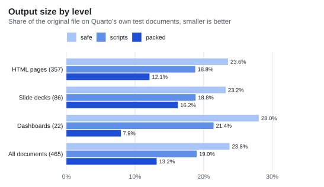
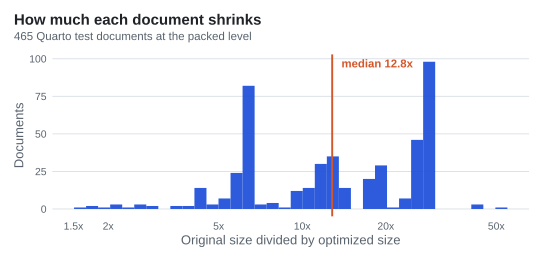
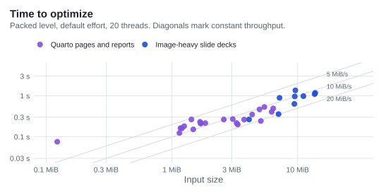
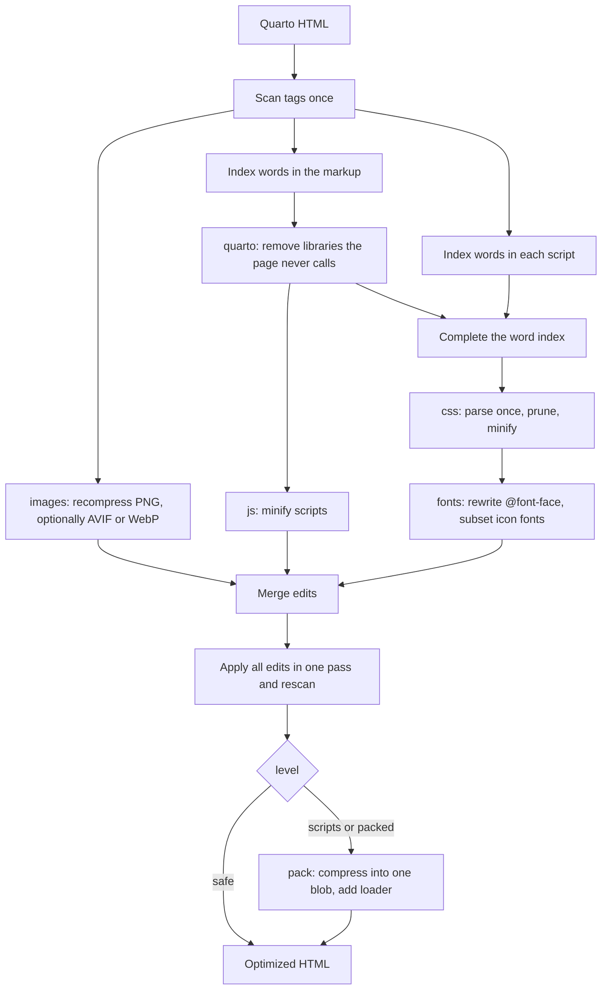

# Octavo

Octavo makes Quarto HTML files smaller. Give it a document rendered with `embed-resources: true` and it writes one self-contained file that opens offline and renders the same. A plain article shrinks 25 times (1.2 MB to 48 KB). Across Quarto's own 465 test documents the median shrinks 12.8 times. Documents whose weight is mostly images shrink about 2 times, because the images are most of the file.

```sh
octavo report.html                          # writes report.min.html
octavo deck.html small.html --lossy-images  # AVIF, much smaller, not pixel-exact
octavo report.html --maximum                # slowest, smallest output. Not reccomended.
octavo --audit report.html                  # what each step would save
```

Octavo reads the document, works out what the page can reach, and hands each format to a library built for it: lightningcss for CSS, oxc for JavaScript, oxipng for PNG, skera for fonts. The libraries are listed [below](#the-libraries-doing-the-real-work).

## Install

```sh
curl --proto '=https' --tlsv1.2 -LsSf https://github.com/VisruthSK/octavo/releases/latest/download/octavo-cli-installer.sh | sh
```

```powershell
powershell -ExecutionPolicy Bypass -c "irm https://github.com/VisruthSK/octavo/releases/latest/download/octavo-cli-installer.ps1 | iex"
```

### Build

To build from source, run `cargo install octavo-cli`. The WOFF2 encoder is C++, so you need a C++ compiler. Font subsetting is pure Rust and needs nothing else.

```powershell
cargo install octavo-cli
```

### Shell completions

`octavo --completions <shell>` prints a completion script and exits. It supports bash, zsh, fish, elvish, PowerShell and nushell.

```sh
octavo --completions bash > ~/.local/share/bash-completion/completions/octavo
octavo --completions zsh > ~/.zfunc/_octavo
octavo --completions fish > ~/.config/fish/completions/octavo.fish
```

```powershell
octavo --completions powershell | Out-String | Invoke-Expression
```

```nu
mkdir ($nu.default-config-dir | path join completions)
octavo --completions nushell | save --force ($nu.default-config-dir | path join completions octavo.nu)
```

For nushell, add `use completions/octavo.nu *` to `config.nu`. For PowerShell, put the line in your profile to keep it.

## Results

Output size as a share of the input, on Quarto's own test documents (every one that renders to self-contained HTML), measured at each level:

<picture>
  <source media="(prefers-color-scheme: dark)" srcset="docs/images/levels-dark.svg">
  
</picture>

| Documents | Count | Input | `safe` | `scripts` | `packed` | Median shrink at `packed` |
|---|---|---|---|---|---|---|
| HTML pages | 357 | 536 MiB | 23.6% | 18.8% | 12.1% | 18.2x |
| Slide decks | 86 | 293 MiB | 23.2% | 18.8% | 16.2% | 6.5x |
| Dashboards | 22 | 66 MiB | 28.0% | 21.4% | 7.9% | 17.1x |
| **All** | **465** | **895 MiB** | **23.8%** | **19.0%** | **13.2%** | **12.8x** |

Per document, the 10th and 90th percentiles of the shrink at `packed` are 5.6x and 28.4x. Slide decks shrink less than pages because most of their size is images, which Octavo recompresses without changing a pixel. Nine image-heavy decks of 4 to 14 MB, 85 MiB in total, come out at 39 MiB.

<picture>
  <source media="(prefers-color-scheme: dark)" srcset="docs/images/distribution-dark.svg">
  
</picture>

Single documents, at `packed`:

| Document | Before | After | Shrink |
|---|---|---|---|
| Plain article | 1.20 MB | 48 KB | 25x |
| Article with figures | 1.26 MB | 147 KB | 8.6x |
| ggplot2 figure (PNG) | 1.23 MB | 114 KB | 10.8x |
| Dashboard with cards | 5.35 MB | 540 KB | 9.9x |
| `gt` table | 1.78 MB | 335 KB | 5.3x |
| reveal.js deck | 3.94 MB | 715 KB | 5.5x |
| Plotly report | 5.70 MB | 1.66 MB | 3.4x |

Widget libraries such as Plotly and reveal.js ship their own minified JavaScript, and that code is the floor for those pages. A file that is already minified has little left to remove.

<picture>
  <source media="(prefers-color-scheme: dark)" srcset="docs/images/speed-dark.svg">
  
</picture>

The median throughput is about 10 MiB/s for pages and 12 MiB/s for decks. Of the 22 pages, 21 take under half a second, and decks of about 14 MB take 1.1 to 1.4 seconds.

### Where the bytes go

A near-empty Quarto article is about 1.2 MB, and almost none of it is your content. `embed-resources` inlines Bootstrap's stylesheet (433 KB, stored as 649 KB of percent-encoded text), the Bootstrap Icons font with its 2,078 icon rules (342 KB), the scripts for Bootstrap, Tippy, Popper, Clipboard.js and Anchor.js (about 160 KB), and the theme and highlighting styles. A page with no code block and no footnote uses almost none of that.

## How it works

Octavo scans the document once and builds a word index of everything the page can reach. Image recompression starts immediately and runs alongside the rest. Quarto detection decides which bundled libraries the page never calls. Once it has decided, JavaScript minification starts, and in parallel the word index is completed and the stylesheet stage runs. Each stage reads the shared scan and returns edits to byte ranges. The edits are merged and applied to the original text in one pass, so anything Octavo does not understand stays exactly as it was.

The stylesheet stage parses each stylesheet into a syntax tree once. Pruning, minification and the font facts all come from that tree, and the font stage rewrites its `@font-face` rules in place.



| Stage | What it does | What stops it |
|---|---|---|
| `quarto` | Removes Bootstrap JavaScript, Popper, Tippy, Clipboard.js and Anchor.js when the markup never uses them, and stubs the globals that Quarto's own runtime calls regardless | The markup uses the library, or another script mentions it |
| `js` | Minifies scripts and turns data-URI module scripts into inline modules | The script does not parse, or is already minified |
| `css` | Deletes rules that need a class, id or tag found nowhere in the markup or any script, then minifies. Custom property values are kept verbatim | A rule the parser rejects, or whose `calc()` arithmetic would lose precision, is kept as written and the rest of the sheet is still optimized |
| `fonts` | Keeps the one source browsers use (the last `src`, preferring WOFF2, then WOFF, then TrueType and OpenType), converts it to WOFF2, drops legacy EOT and SVG copies, subsets icon fonts to the glyphs the CSS can reach, and drops fonts nothing mentions. Text fonts stay whole unless you pass `--subset-fonts` | The family name is written with escapes |
| `images` | Recompresses embedded PNGs losslessly. With `--lossy-images`, re-encodes PNG and JPEG as AVIF or WebP and shrinks anything wider than 3840 px | Lossless recompression skips images over 40 megapixels |
| `pack` | Gathers scripts, styles, stylesheet links, inline SVG, images and data blocks into one compressed blob, restored in place by a synchronous loader. The blob uses DEFLATE or Brotli, whichever gives the smaller page | A Content-Security-Policy meta tag. Modules and import maps are never packed |

### What Octavo knows about Quarto

All Quarto-specific knowledge is in one small table in `quarto.rs`:

- Which bundled library each Quarto feature needs. Tippy and Popper power footnote, citation and cross-reference popups and code annotations. Bootstrap's JavaScript serves `data-bs-*` components, Clipboard.js serves `code-copy-button`, and Anchor.js serves `anchored` headings.
- Quarto's own scripts (ids starting `quarto-html-`) call those globals unconditionally. When a library is removed, Octavo leaves a null object in its place so those calls do nothing and do not throw.
- Each library is recognized by its banner comment, so a script that only mentions `bootstrap` is not mistaken for it.

Everything else in the code only knows about HTML, CSS, JavaScript, fonts and images.

### Levels

| Level | Behaviour |
|---|---|
| `safe` | Minify and prune. Stylesheets and scripts stay real elements, so the page works with JavaScript off. |
| `scripts` | Also packs scripts and data blocks. Stylesheets and SVG stay real. |
| `packed` | Packs everything. The page needs JavaScript to be styled, so use it for documents that already need JavaScript. |

Output size shrinks in the order `safe`, `scripts`, `packed`.

`--audit` prints what each step saves at the chosen level and writes nothing:

```
step               count     before      after      saved
dead-library           3   93.5 KiB      160 B   93.4 KiB
script-minified        7   57.7 KiB   20.4 KiB   37.3 KiB
stylesheet-pruned      6    2.3 MiB  411.8 KiB    1.9 MiB
packed                 1  751.1 KiB  458.1 KiB  293.0 KiB

packed level: 2.8 MiB -> 458.1 KiB (6.3x smaller)
```

Each row covers only the part of the file that step changed, and the steps run in the order shown.

### Compression effort

The level decides what the output depends on. The effort decides how hard the compressors work, and it applies at every level. The default balances size against time. `--maximum` uses the slowest settings everywhere. Three flags set the values yourself, and none can be combined with `--maximum`:

| Flag | Range | Balanced | Maximum |
|---|---|---|---|
| `--woff2-quality` | 0 to 11 | 9 | 11 |
| `--png-preset` (oxipng) | 0 to 6 | by image size | 6 |
| `--brotli-quality` (packed blob) | 0 to 11 | 6, used when the page ends up smaller than with DEFLATE, counting Brotli's decoder | 11, always tried |

On a 288 KB font, WOFF2 quality 9 takes 26 ms and quality 11 takes 293 ms for 9 percent more bytes.

### Fonts

Fonts converted whole are remembered in your user cache directory (`~/.cache/octavo` on Linux, `~/Library/Caches/octavo` on macOS, `%LOCALAPPDATA%\octavo` on Windows), in a `fonts` subfolder with one file per distinct font, named by a hash of its bytes and quality. Documents from the same theme embed the same fonts, so later runs skip the slowest step. Subsetted fonts are never stored. `--cache-dir <directory>` chooses another place and `--no-cache` turns the cache off.

Text fonts stay whole by default. `--subset-fonts` cuts them to the characters the document uses plus the Latin letters, digits and punctuation, which is often the largest saving in a themed document, because Quarto themes embed whole fonts such as Source Sans. Subsetting uses [skera](https://crates.io/crates/skera) and keeps every layout feature the font has, so kerning, tabular and old-style numbers, small caps and stylistic sets all survive and layout is identical. Chromium on Linux draws some hinted static fonts, Fira Sans among them, with slightly different stroke shading after subsetting, and the checker reports that as pixel differences. Text that JavaScript adds later with characters outside the kept set falls back to a system font. Icon fonts are always subsetted to the glyphs the CSS can reach.

### Licenses

Bundled libraries carry license banners, and the MIT, BSD and Apache licenses require them to travel with copies. Octavo keeps them by default, which costs 400 bytes to 2 KB per document. Subsetting a font discards the copyright and license fields in its name table, so Octavo copies those fields (copyright line, license description, license URL) into a comment beside the font's `@font-face`, which the SIL Open Font License allows. `--strip-licenses` removes all of these notices for people who ship them another way.

### What Octavo refuses

Octavo stops with an error when the input is not what it expects:

- A file with no `<html>` element is not an HTML document.
- A document that links to local files (`site_libs/bootstrap.min.css`, `figure.png`) was not rendered with `embed-resources: true`. The error lists the files.

Resources loaded from the network (a CDN script, a web font) do not stop the run. They are reported as warnings, because the page cannot work offline.

## Sites

`octavo <directory>` optimizes the shared files of a rendered Quarto website once, instead of once per page. Point it at the output of a normal `quarto render` (the `_site` directory), not at pages rendered with `embed-resources: true`:

```sh
octavo _site                  # writes _site.min
octavo _site public           # writes public
octavo _site _site --in-place  # rewrites in place, which cannot be undone
node verify/site.mjs _site _site.min   # compare every page in Chromium
```

Octavo reads every page, builds one index of the words used by all pages and all scripts, and then changes each shared file once:

| File | What happens |
|---|---|
| Stylesheets that a page links, and any they import | Rules are pruned against the whole site's index, so a rule stays if any page needs it, and the sheet is minified |
| Scripts that a page loads | Minified, as a module or a classic script according to how the page loads it |
| WOFF, TrueType and OpenType fonts | Converted to WOFF2, and the `url()` that names them is rewritten. With `--subset-fonts` the text fonts are also cut to the characters that any page, script, stylesheet or JSON file of the site can show, and stay whole when one of those files cannot be read. The original font is removed unless another file mentions its name |
| PNG images | Recompressed without changing a pixel. With `--lossy-images`, PNG and JPEG images that every page draws at a known width are instead re-encoded once as AVIF or WebP at the largest width any page draws them at, under the new format's name, and the pages' `src` attributes follow. An image stays lossless when its size is unknown on any page, when it is referenced outside `` tags, and when a PNG has partial transparency |

Run it on a complete, fresh render of the site. Octavo removes every style rule that no page in the directory uses, so a partial or incremental build, or a page published later from another build, can lose styling. Write to a separate output, which is the default, and run it again when pages change. Rewriting a directory in place needs `--in-place`, because it cannot be undone.

The output is written in full before any of it is published. Octavo builds the whole tree in a staging directory next to the output, checks that every file it planned is there with the planned size, and only then puts the tree in place. Putting it in place is a sequence of renames and not a single atomic operation: the old output is renamed aside, the staged tree is renamed into its place, and the old tree is deleted afterwards. A reader that opens the output between the two renames finds nothing there for a moment, but never a half-written tree. If the second rename fails, the old tree is put back and the run reports the error. If the run fails before the promotion, the staging directory is removed and the previous output stays exactly as it was, byte for byte. The tree is built from scratch every time, so a file left over from an earlier run that is no longer part of the site does not survive. Rewriting a directory in place uses the same steps, so the original directory is only removed once the new tree is in place.

Pages and every other file are copied unchanged, and files keep their names, so the site works as before and browsers still cache each shared file once. With `--subset-fonts`, text fonts are also cut to the characters that any page, script, stylesheet or JSON file of the site can show, including text that only the search index reveals; when one of those files cannot be read, every text font stays whole. With `--lossy-images`, PNG and JPEG images that every page draws at a known width are re-encoded once as AVIF or WebP at the largest width any page draws them at, under the new format's name, with the pages' `src` attributes rewritten to match; every other image is recompressed losslessly or left as it is, and a browser that has cached a file under its old content needs to revalidate it, so serve optimized files with a new URL or a short cache lifetime.

Only regular files are read. A symbolic link that points at a regular file inside the site is copied as a regular file, and a symbolic link that points outside the site is an error that names the path. Any other kind of entry, such as a named pipe or a device, is an error too, so nothing is left out silently.

A visitor's download, with each file Brotli-compressed as a static host sends it and shared files fetched once:

| Site | Pages | First page | Five pages | Same site after `octavo` |
|---|---|---|---|---|
| Text pages | 5 | 351 KB | 379 KB | 260 KB and 287 KB |
| Blog with a grid listing | 6 | 439 KB | 525 KB | 348 KB and 433 KB |
| Listings with 30 screenshots | 15 | 1,413 KB | 1,989 KB | 1,093 KB and 1,524 KB |

The same pages rendered with `embed-resources: true` each carry their own copy of the dependencies: 617 KB for the first page of the text site and 4.3 MB for five, because 49% to 89% of the bytes are copies repeated across pages. Octavo shrinks those pages, but a reader of several pages still downloads several times what the normal site sends, so use per-page embedding for documents that are read once and site mode for sites.

## Limits

- `packed` rebuilds stylesheets with JavaScript while the page is parsed, so it needs JavaScript.
- The Brotli decoder runs through `new Function`, and `packed` uses Brotli whenever that makes the page smaller, which is common for large pages and for decks that repeat images. A page served with an HTTP `Content-Security-Policy` header that forbids `unsafe-eval` cannot load such a page. A `<meta>` policy is detected and disables packing, but a policy sent as a header is invisible to a static file. If you send that header, allow `unsafe-eval` for the packed pages or use `--level scripts`, which never needs it.
- Modules, import maps and elements whose attributes contain character references are never packed.
- Site mode follows static references (`<link>`, `<script src>`, `@import` and `url()`). A file that a script loads at run time under a name Octavo cannot see is left as it is, and a stylesheet that no page links is not pruned.
- `--subset-fonts` can change how some hinted fonts are drawn on Linux, as described under [Fonts](#fonts).

## The libraries doing the real work

| Job | Library |
|---|---|
| Parse, prune and minify CSS | [`lightningcss`](https://crates.io/crates/lightningcss) |
| Parse, mangle and minify JavaScript | [`oxc`](https://crates.io/crates/oxc) |
| Subset fonts | [`skera`](https://crates.io/crates/skera) |
| Write WOFF2 | [`woofwoof`](https://crates.io/crates/woofwoof), which wraps Google's WOFF2 encoder |
| Decode WOFF and WOFF2 input | [`wuff`](https://crates.io/crates/wuff) |
| Recompress PNG losslessly | [`oxipng`](https://crates.io/crates/oxipng) |
| Decode PNG and JPEG | [`image`](https://crates.io/crates/image) |
| Encode lossy AVIF | [`ravif`](https://crates.io/crates/ravif), built on rav1e |
| Encode lossy WebP | [`gamut-webp`](https://crates.io/crates/gamut-webp) |
| Resize images | [`fast_image_resize`](https://crates.io/crates/fast_image_resize) |
| Deflate the packed blob | [`libdeflater`](https://crates.io/crates/libdeflater), level 12 |
| Brotli for the packed blob | [`brotli`](https://crates.io/crates/brotli) |
| Text-safe encoding of the blob | [`base91`](https://crates.io/crates/base91) |
| Name cached fonts | [`blake3`](https://crates.io/crates/blake3) |

Apart from a small tag scanner that records byte ranges and two tiny CSS helpers (one splits a stylesheet into top-level rules, one masks license comments), Octavo parses and encodes no format by hand. The non-Rust code in the build is the WOFF2 encoder behind `woofwoof` and libdeflate behind `oxipng` and `libdeflater`.

## As a library

The `octavo` crate is the whole optimizer, and the command line is a thin wrapper around it. `Mode` is `Safe`, `Scripts` or `Packed`, matching the three command-line levels.

```rust
use octavo::{optimize, Mode};

let out = optimize(&html, Mode::Packed)?;
println!("{} -> {} bytes", html.len(), out.html.len());
for step in &out.applied {
    println!("{} {}: {} -> {}", step.transform, step.target, step.before, step.after);
}
for warning in &out.warnings {
    eprintln!("warning: {warning}");
}
```

`simplify` runs the stages that do not depend on a mode, and `Simplified::pack` finishes the result for each mode. `Simplified::pack_checked` tries a mode, hands the result to a check you supply, and steps down to the next safer mode when the check says no, so a browser comparison or any other test can sit between Octavo and the file it writes.

`Options` carries the choices that change the result, and `Compression` sets the effort:

```rust
use octavo::{simplify, Compression, Mode, Options, Tuning};

let options = Options {
    compression: Compression::Custom(Tuning { woff2_quality: 10, ..Tuning::BALANCED }),
    cache_directory: Some("fonts-cache".into()),
    ..Options::default()
};
let out = simplify(&html, options)?.pack(Mode::Packed);
```

`Compression::Balanced` is the default, `Compression::Maximum` uses the slowest settings, and `Compression::Custom` takes a `Tuning` with the three values from the table above.

## Verification

`verify/` opens the original and the optimized file in Chromium and compares them. A browser is found automatically (Chrome, Chromium or Edge, or Playwright's own build). Set `CHROME_PATH` to choose one. It compares:

- console errors and network requests
- the serialized DOM and the accessibility tree
- the computed style of every element, including pseudo-elements and forced hover, focus and active states
- loaded fonts and full-page screenshots
- every running animation: its target, timing and keyframes, so a pruned `@keyframes` rule is caught

Screenshots must match pixel for pixel. The checker allows one level out of 255 in a colour channel for rendering rounding, and up to twelve isolated pixels off by at most eight levels for antialiasing noise. Computed styles and layout boxes are always compared exactly, and every tolerated pixel is counted in the report. A linear gradient and its mirror image compare as equal, because they paint the same pixels.

This runs in desktop light, desktop dark, mobile, tablet, print, JavaScript-off and animations-on scenarios, followed by an interaction sweep: colour-scheme toggle, tabs, collapses, hovers, key presses and scrolling. `Math.random` is seeded so widget ids repeat, and transitions are switched off (except in the animations-on scenario) so timing does not leak into the comparison.

When a comparison finds a difference, both pages are captured up to three more times, with the later captures waiting longer. A difference counts only if it appears in every capture and neither page ever disagrees with its own recaptures. A page that settles into different stable states on different loads is therefore not reported as a difference, and a real change always is. `verify/verifier.test.mjs` checks the checker: it breaks a page in a dozen specific ways (a dropped keyframes, hover, dark, print or media rule, a colour off by one, a 0.02 px layout shift) and each must be caught.

With `--lossy-images`, pass `--lossy` to the checker. Image bytes are then not compared, dimensions still are, and screenshots may differ by up to 2% of pixels.

```sh
cargo test
cd verify && npm install && node --test
node verify.mjs original.html optimized.html [--allow-js-required]
node bench.mjs packed ../corpus/html/train ../corpus/html/test
```

A pass means the tested matrix matched. It is not a proof of equivalence.

On a busy machine, large pages loaded side by side can land in different timing states (scroll-view scrollbars, footnote popups, MathJax). Set `OCTAVO_PAGES=1` to load one page at a time and get deterministic comparisons.

### The corpus

`corpus/` holds the test corpus: 318 hand-written adversarial and realistic fixtures (parsing, CSS, scripts, images, fonts, Quarto-style pages, libraries, large pages) and the 465 documents from Quarto's own test suite that render to self-contained HTML, across pages, slides and dashboards. Every fixture states its expected outcome up front: optimize, keep unchanged, or reject.

```sh
cargo build --release
node corpus/build.mjs                       # regenerate manifest.json, or --check it
node corpus/upstream.mjs                    # render the real pages (needs Quarto)
node verify/corpus.mjs --tier smoke --browser
node verify/corpus.mjs --tier full --browser --jobs 2
```

The full tier runs all three levels and is slow, so CI splits it across 24 shards and runs it before every release tag. A sample of 71 documents runs on every push and pull request. See [`corpus/README.md`](corpus/README.md) for the format and how to add documents.

## Releases

Pushing a version tag runs the CI suite and the full corpus first. The binaries are built and the GitHub release is created only if both pass.

## Quarto integration

`integrations/quarto/octavo-post-render.ts` runs Octavo as a project `post-render` step.

## License

Licensed under either of [Apache License, Version 2.0](LICENSE-APACHE) or [MIT license](LICENSE-MIT) at your option.
